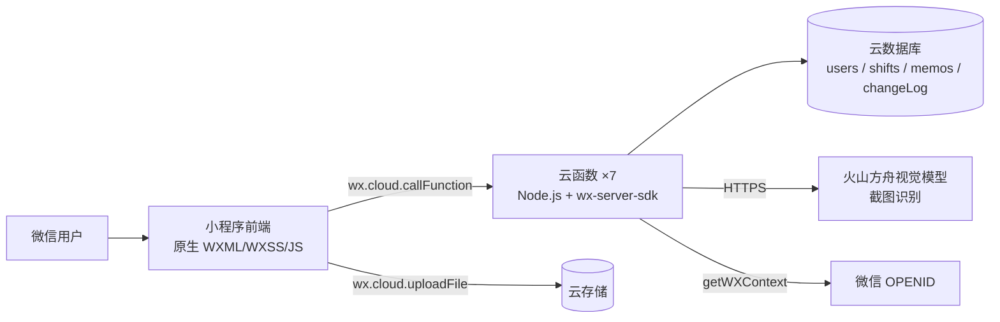

# 日历排班小程序（Calendar Shift MiniApp）

给小型排班团队（门店、客服组、值班岗）用的微信小程序：**拍一张排班截图，AI 识别成结构化班表**，之后在日历上点选改班、区分管理员与成员权限、记个人备忘录。

不用 Excel 转来转去，也不用在微信群里口头换班。

## 一、项目状态

| 项 | 现状 |
|---|---|
| 版本 | 体验版 **1.2.1** 已上传（1.1.0 曾设为体验版）；**正式版尚未提交审核** |
| 使用者 | **2 人**（本人 + 1 位同事），2026-10-16 起在用 |
| 提交 | **62 次提交**，按任务编号推进（T-001 ~ T-026） |
| 代码规模 | 8 个页面 + 7 个云函数 + 4 个云数据库集合 |
| 测试 | **20 个测试文件**（Node 运行，含 mock 云环境，覆盖改班/权限/导入/软删除/年份/隐私等） |
| 文档 | **31 份**（PRD、架构、数据模型、接口契约、决策记录、已知问题、验收计划 + 9 份阶段交接摘要） |
| 缺陷治理 | 审查后确认 **25 个缺陷并逐个修复**（BUG-001 ~ BUG-025，见 `docs/known-issues.md`） |

> 说明：这是一个**小团队内部工具**，不是面向市场的产品，所以使用者只有 2 人。项目的重点在**把一条真实业务链路做对、做全、做可维护**，而不在用户规模。

## 二、它解决什么问题

排班岗的老办法是：Excel 排表 → 截图发群 → 换班在群里喊 → 月底靠人肉统计。

三个真实的痛点：

1. **图是死的**：排班永远是别人发来的一张图，看不到自己哪天上班。
2. **换班靠喊**：谁跟谁换了，没人留痕，月底对不上。
3. **改一次全表重排**：一个人请假，整张表要重做一遍。

这个小程序把「图」变成「数据」：截图 → AI 识别 → 人工校对 → 入库成日历，之后每个人只看自己的日历、点一下就改班。

## 三、核心功能

| 模块 | 能力 |
|---|---|
| **AI 截图导入** | 上传排班截图 → 火山方舟视觉模型识别成员与每日班次 → **预览逐项人工校对** → 按「成员 + 月份」整月覆盖入库 |
| **Excel 导入** | 上传 `.xlsx`，纯函数解析出与截图一致的预览结构 |
| **整表导入** | 管理员一次识别多成员，一次 AI 调用导入整表（省费用） |
| 日历视图 | 月视图（周一为首列）、上下月切换、灰色补位日不可改 |
| 改班 | 点选改班 / 长按批量改班 / 取消班次；11 种班次 + 年假 |
| 权限 | 成员只能改自己的；管理员可改所有人、可切换成员视角 |
| 成员管理 | 绑定已有成员、新建并绑定、软删除（保留历史排班）、解绑 |
| 备忘录 | 个人备忘录 CRUD，按年 + 月过滤（避免跨年重复出现） |
| 统计 | 本月休/白/晚班计数 |
| 设置 | 管理员可见的设置页与技术栈页 |

## 四、技术架构



| 层 | 技术 |
|---|---|
| 前端 | 微信小程序原生（基础库 3.17.3），自研日历组件 |
| 后端 | 微信云函数 ×7（Node.js + `wx-server-sdk`） |
| 数据 | 微信云数据库，4 个集合：`users` / `shifts` / `memos` / `changeLog` |
| 存储 | 云存储（截图上传） |
| 外部 | 火山方舟视觉模型（截图识别，Key 不入库） |
| 部署 | 微信开发者工具上传，云函数右键「上传并部署」 |

### 云函数职责

| 函数 | 职责 |
|---|---|
| `login` | 身份判定（OPENID）、自动建档、多记录合并 |
| `getShifts` | 按年/月读排班与成员（已加分页） |
| `updateShift` | 改班/清空 + 写修改日志 + **权限校验** |
| `importShift` | 截图识别、姓名归位、整月覆盖入库、建成员 + **权限校验** |
| `manageMember` | 成员列表/绑定/新建/移除（软删除）/解绑 + 管理员校验 |
| `manageMemo` | 个人备忘录 CRUD |
| `manageSettings` | 管理员设置项 |

## 五、权限模型

- **身份**：微信 `OPENID`（云函数 `getWXContext()`），无独立账号体系。
- **管理员判定**：`ADMIN_OPENIDS` 白名单 **或** 数据库 `users.role === 'admin'`。
- **后端校验点**：`manageMember.checkAdmin`、`updateShift`（T-002）、`importShift`（T-004）。
- **前端 `storage.session` 只用于渲染，不作为权限依据** —— 所有写操作都在云函数侧重新判定。

这套模型是审查后重建的：审查初期发现「任意登录成员都能改任意人的排班」（BUG-001），属于高危缺陷，已按「成员只能改自己、管理员可改全部、越权返回 `ok:false`」重做。

## 六、数据模型（4 个集合）

| 集合 | 用途 | 关键字段 |
|---|---|---|
| `users` | 成员与身份 | `openid`、`name`、`role`(admin/member)、`isDeleted` |
| `shifts` | 每人每天一条排班 | `userId`→users._id、`date`(YYYY-MM-DD)、`shiftType` |
| `memos` | 个人备忘录 | `openid`、`text`、`createdAt` |
| `changeLog` | 改班审计日志 | `userId`、`date`、`oldShift`、`newShift`、`operator` |

## 七、工程过程（这个项目真正做了什么）

1. **先审计**：对既有代码做现状盘点（`docs/architecture.md`、`module-map.md`、`existing-project-audit.md`），只记录代码里已经存在的事实。
2. **列缺陷**：确认 25 个缺陷（含 4 个高危：零权限校验、导入越界建成员、导入不覆盖、年份写死）与 10 项风险。
3. **按任务修**：每个缺陷一个任务编号（T-001 ~ T-026），每次修复带可数验收判据。
4. **补测试**：20 个测试文件，覆盖权限越权（T-002 9 条 / T-004 11 条）、软删除、年份、Excel 解析、隐私字段等。
5. **出文档**：31 份文档，含 9 份阶段交接摘要 —— 换个人接手能直接读完继续做。
6. **发版**：云函数 7/7 部署，客户端体验版上传，2 名使用者真实在用。

## 八、已知限制（诚实清单）

| 限制 | 说明 |
|---|---|
| 规模未验证 | 只有 2 名使用者；成员数 × 31 天超过 1000 行时需要分页（已实现，待线上复测） |
| 无唯一索引 | `shifts` 未加 `(userId, date)` 唯一约束，并发下理论上可能出现同人同天多条（RISK-008） |
| 修改日志只写不读 | `changeLog` 有写入，暂无查询界面 |
| 无 CI/CD | 部署靠开发者工具手动上传 |
| 正式版未提交审核 | 体验版可用，正式版仍在准备 |
| 视觉识别依赖外部模型 | 识别结果必须人工校对；未建截图回归样例集（RISK-006） |

## 九、本地运行

1. 安装微信开发者工具，导入本目录（`project.config.json` 已配好 `miniprogramRoot` 与 `cloudfunctionRoot`）。
2. 开通云开发环境，把环境 ID 写入 `miniprogram/config.js`。
3. 右键 `cloudfunctions/` 下 7 个函数 → 「上传并部署（云端安装依赖）」。
4. 截图导入需要视觉模型：把端点与 Key 写入 `cloudfunctions/importShift/config.json`（**该文件不入库**，缺失时导入会明确报失败，不会返回假数据）。
5. 云数据库建 4 个集合：`users` / `shifts` / `memos` / `changeLog`。
6. 管理员：把自己的 OPENID 填进 `login` 函数的 `ADMIN_OPENIDS`，或把库内 `users.role` 改为 `admin`。

## 十、目录结构

```
miniprogram/                 # 小程序前端（8 个页面 + 自研日历组件 + utils）
  pages/                     # calendar / import / login / members / memo / mine / settings / techstack
  components/calendar/       # 自研月历组件
  utils/                     # calendar.js（月网格）/ shift.js（班次常量与颜色）
cloudfunctions/              # 7 个云函数（Node.js）
  login/ getShifts/ updateShift/ importShift/ manageMember/ manageMemo/ manageSettings
tests/                       # 20 个测试文件 + mock 云环境
docs/                        # 31 份文档（PRD / 架构 / 数据模型 / 接口契约 / 决策 / 已知问题 / 交接摘要）
sync-config.py               # 参数分发：清单 → 前端与云函数配置
```

## 十一、文档索引

| 想知道什么 | 看哪份 |
|---|---|
| 要做什么、为什么 | `docs/项目需求文档PRD.md` |
| 现有代码长什么样 | `docs/architecture.md`、`docs/module-map.md` |
| 数据结构 | `docs/data-model.md` |
| 接口约定 | `docs/api-contract.md` |
| 为什么这么改 | `docs/decisions.md`（ADR） |
| 有哪些坑 | `docs/known-issues.md` |
| 怎么验收 | `docs/acceptance-test-plan.md` |
| 怎么部署 | `docs/deployment.md` |
| 经验教训 | `docs/lessons.md` |
