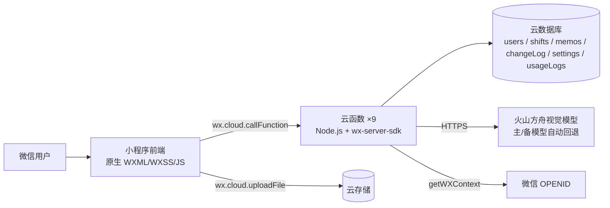

# 日历排班小程序（Calendar Shift MiniApp）

给小型排班团队（门店、客服组、值班岗）用的微信小程序：**拍一张排班截图，AI 识别成结构化班表**，之后每个人看自己的日历、点一下改班；管理员负责成员、导入和数据。

> 这不是一个"用户量很大"的产品，而是一条真实跑通的业务链路：截图 → 识别 → 人工校对 → 入库 → 改班 → 统计。重点是把权限、异常、数据和验收做对。

## 一、项目状态

| 项 | 现状 |
|---|---|
| 代码 | 微信小程序原生 + 微信云开发：**9 个页面、9 个云函数、6 个云数据库集合** |
| 提交 | **83 次提交**（2026-10-06 ~ 2026-10-28），提交信息按 `feat / fix / docs / test` 分域 |
| 测试 | **28 个测试文件 / 140 条用例**（Node 内置 `node --test`，含云函数与云数据库 mock） |
| 文档 | **25 份 Markdown**：PRD、架构、模块地图、数据模型、接口约定、ADR、验收计划、部署、操作手册、阶段交接 |
| 任务 | **T-001 ~ T-036**，一个任务一张卡，每张卡带可数验收判据 |
| 缺陷治理 | 审查确认 **25 个缺陷（6 高 / 14 中 / 4 低）**，已修 24 个；另有 **10 项风险**登记在案 |
| 使用者 | 2 名固定使用者（作者 + 1 位同事），2026-10-16 起日常在用 |
| 发布 | 体验版 **1.3.6 已上传**；正式版未提交审核 |
| 安全 | 仓库不含真实 API Key 与管理员 openid；参数走示例文件 + 本地同步脚本 |

## 二、解决什么问题

排班岗的老办法是：Excel 排表 → 截图发群 → 换班在群里喊 → 月底人肉统计。三个痛点：

1. **图是死的**：排班永远是别人发来的一张图，看不到自己哪天上班。
2. **换班靠喊**：谁跟谁换了没人留痕，月底对不上。
3. **改一次全表重排**：一个人请假，整张表重做。

小程序把「图」变成「数据」：截图 → AI 识别 → 人工校对 → 入库成日历，之后按成员看日历、点选改班。

## 三、核心功能

| 模块 | 能力 |
|---|---|
| **AI 截图导入** | 上传排班截图 → 视觉模型识别成员与每日班次 → 逐项人工校对 → 按「成员 + 月份」整月覆盖入库 |
| **Excel 导入** | 上传 `.xlsx`，纯函数解析出与截图一致的预览结构 |
| **目标月份** | 导入页可选月份（当前月 −12 ~ +24）。选了月份就以该月为准：日期按「日」重写到目标月，目标月不存在的日期（如 11-31）丢弃并提示 |
| **空月导入入口** | 当前成员当月无排班时，日历「批量」右侧显示「导入」；有排班或手动改班后自动隐藏 |
| **日历与改班** | 月视图（周一为首列）、上下月切换、点选改班、长按批量、取消某天班次 |
| **4/6 排班状态** | 4 状态：休/白班/晚班/年假；6 状态：休/正A/正B/售A/售B/年假；可按导入数据自动切 6，也可手动切换 |
| **成员管理** | 绑定、新建并绑定、改名（只改名字不动排班）、解绑、软删除（保留历史排班） |
| **权限** | 成员只能改自己的；管理员可改全部、切换成员视角；管理员日历不显示"删除成员" |
| **备忘录** | 个人备忘录 CRUD，按年 + 月过滤 |
| **数据页** | 管理员查看成员/排班/备忘录，以及用户数、使用频次、上线时长、累计用户、近 30 天活跃 |

## 功能截图

> 截图为演示数据：成员名统一显示为「成员B」，管理员显示为「管理员」，**真实姓名已隐藏**。

  
  
  

  
  

每一页的进入路径、交互与边界见 [docs/功能说明.md](docs/功能说明.md)。

## 四、技术架构

| 层 | 技术 |
|---|---|
| 前端 | 微信小程序原生（基础库 3.17.3），自研日历组件，CSS 变量主题 |
| 后端 | 微信云函数 ×9（Node.js 16.13 + `wx-server-sdk`） |
| 数据 | 云数据库 6 个集合：`users` / `shifts` / `memos` / `changeLog` / `settings` / `usageLogs` |
| 存储 | 云存储（排班截图） |
| 外部 | 火山方舟 Ark Chat Completions（视觉识别，主/备模型可切换） |
| 部署 | 微信开发者工具 + 云函数上传；体验版上传 |

### 云函数职责

| 函数 | 职责 |
|---|---|
| `login` | 身份判定（OPENID）、自动建档、忽略软删除 |
| `getShifts` | 按年/月读排班与成员（分页，过滤软删除） |
| `updateShift` | 改班/清空 + 修改日志 + 权限与日期校验 |
| `importShift` | 截图/Excel 识别、姓名归位、整月覆盖、目标月重写、主备模型回退 |
| `manageMember` | 成员列表/绑定/新建/改名/软删除/解绑 + 管理员校验 |
| `manageMemo` | 个人备忘录 CRUD |
| `manageSettings` | 识别服务配置的读取与修改（仅管理员） |
| `getStats` | 管理员读取使用统计（累计用户/启动/近30天活跃/上线天数） |
| `trackUsage` | 记录启动，用于使用统计（失败静默） |

## 五、权限与安全

- **身份**：微信 `OPENID`（`cloud.getWXContext()`），无独立账号体系。
- **管理员**：`ADMIN_OPENIDS` 白名单优先，兼容库内 `users.role === 'admin'`。
- **后端校验点**：`manageMember`、`updateShift`、`importShift`、`manageSettings`、`getStats`。
- **前端 `storage.session` 只用于渲染**，所有写操作在云函数侧重新判定。
- **密钥边界**：
  - 仓库不提交 `cloudfunctions/*/config.json`、`project.private.config.json`、真实《人工必填参数清单.json》；
  - 首次部署用 `人工必填参数清单.example.json` 复制后填入，再由 `sync-config.py` 下发；
  - 识别模型的密钥只在服务端读取、仅管理员可修改，不落到前端；
  - 仓库内任何截图与文档都不含密钥；密钥一旦外泄，立即到服务商重置。

## 六、数据模型（6 个集合）

| 集合 | 用途 | 关键字段 |
|---|---|---|
| `users` | 成员与身份 | `openid`、`name`、`role`、`isDeleted` |
| `shifts` | 每人每天一条排班 | `userId`→users._id、`date`(YYYY-MM-DD)、`shiftType` |
| `memos` | 个人备忘录 | `openid`、`text`、`createdAt` |
| `changeLog` | 改班审计日志（容错写入） | `userId`、`date`、`oldShift`、`newShift` |
| `settings` | 识别服务配置（仅管理员可读） | 模型名与密钥（密钥字段不在本文档展开） |
| `usageLogs` | 启动埋点 | `openid`、`event`、`day`、`createdAt` |

## 七、本地运行

1. 安装微信开发者工具，导入本目录（`project.config.json` 已配 `miniprogramRoot` 与 `cloudfunctionRoot`）。
2. 复制参数模板：`人工必填参数清单.example.json` → `人工必填参数清单.json`，填写云环境、管理员 openid、识别接口端点与模型等信息。
3. 双击《同步参数.bat》或运行 `python sync-config.py`，生成 `miniprogram/config.js` 与各云函数 `config.json`。
4. 在云开发控制台创建集合：`users` / `shifts` / `memos` / `changeLog` / `settings` / `usageLogs`（`changeLog` 可按需）。
5. 右键 `cloudfunctions/` 下 9 个函数 → 上传并部署（云端安装依赖）。
6. 管理员：把 OPENID 填进 `ADMIN_OPENIDS`，或把库内 `users.role` 改为 `admin`。
7. 运行测试：见下一节。

更细的日常操作、部署、排障见 [docs/操作手册.md](docs/操作手册.md)。

## 八、测试与验收

| 项 | 内容 |
|---|---|
| 规模 | 28 个测试文件 / **140 条用例**，`node --test`，云函数与云数据库用 `tests/helpers/mock-cloud.js` 打桩 |
| 跑法 | 逐文件跑 `node --test tests/t002-update-shift.test.js`。注意 Node 22 下 `node --test tests` 会把目录当模块，报 `MODULE_NOT_FOUND` |
| 验收文档 | [docs/acceptance-test-plan.md](docs/acceptance-test-plan.md)，每条判据要求"可数" |

**用例压在出过事的地方**（不是凑覆盖率）：

| 关注点 | 对应测试 |
|---|---|
| 越权改班 / 导入白名单 | `t002-update-shift`、`t023-import-admin-whitelist` |
| 导入覆盖、整表导入、目标月份重写 | `t004-import-shift`、`t009-import-all`、`t031-month-normalize` |
| 软删除保留历史 | `t003-soft-delete` |
| 空月导入入口、未来月份 | `t028-import-button`、`t027-future-month` |
| 隐私（真实姓名不外泄） | `t012-privacy` |
| 视觉回归（主题色、调休紫） | `t013/t014/t015-visual`、`t017-blue-accent`、`t032-tiaoxiu-color` |
| 使用统计 | `t034-usage-stats` |

## 九、已知限制（诚实清单）

| 限制 | 说明 |
|---|---|
| 规模未验证 | 2 名使用者；成员数 × 31 天超 1000 行时分页已实现，待更大规模复测 |
| 无唯一索引 | `shifts` 未加 `(userId, date)` 唯一约束，并发下理论可能重复（RISK-008，待确认线上实际重复数） |
| 审计字段不一致 | 日历改班写 `users._id`、导入写 `OPENID`，`updatedBy` 类型不统一（BUG-023，待修） |
| 无限流 | 云函数入口无调用频率/额度限制，刷识别接口会产生费用（RISK-005） |
| 两套导入流程 | 登录页与导入页各有一套解析逻辑，行为不完全一致（RISK-007） |
| 修改日志只写不读 | `changeLog` 有写入，暂无查询界面 |
| 无 CI/CD | 部署靠开发者工具手动上传 |
| 正式版未审核 | 体验版可用；正式版仍待提交 |
| 识别依赖外部模型 | 识别结果必须人工校对；未建截图回归样例集（RISK-006） |
| 使用统计从接入起 | `usageLogs` 从 2026-10-28 接入，历史访问无法追溯 |

## 十、工程过程

1. **先审计**：读现有代码，记录事实（`existing-project-audit.md` / `architecture.md` / `module-map.md`）。
2. **列缺陷**：25 个确认缺陷（6 高）+ 10 项风险，每条写复现步骤与证据行号。
3. **按任务修**：T-001 ~ T-036，一个任务一个验收判据；小步提交，一件一议。
4. **补测试**：28 个测试文件 / 140 条，覆盖越权、软删除、导入覆盖、目标月份、隐私、视觉、使用统计。
5. **出文档**：PRD、架构、数据模型、接口、ADR、验收、部署、操作手册、阶段交接摘要。
6. **发版**：9 个云函数部署，体验版 1.3.6 上传，2 名使用者真实在用。

## 十一、文档索引

| 想知道什么 | 看哪份 |
|---|---|
| 日常怎么操作 | [docs/操作手册.md](docs/操作手册.md) |
| 先看页面和功能 | [docs/功能说明.md](docs/功能说明.md) |
| 要做什么、为什么 | [docs/项目需求文档PRD.md](docs/项目需求文档PRD.md) |
| 代码结构 | [docs/architecture.md](docs/architecture.md)、[docs/module-map.md](docs/module-map.md) |
| 数据结构 | [docs/data-model.md](docs/data-model.md) |
| 接口约定 | [docs/api-contract.md](docs/api-contract.md) |
| 为什么这么改 | [docs/decisions.md](docs/decisions.md) |
| 有哪些坑 | [docs/known-issues.md](docs/known-issues.md) |
| 怎么验收 | [docs/acceptance-test-plan.md](docs/acceptance-test-plan.md) |
| 怎么部署 | [docs/deployment.md](docs/deployment.md) |

## 十二、AI 参与边界

编码由 AI 辅助执行；**数据模型、权限判断、异常处理、验收测试由作者把关**。本项目 25 个审查缺陷里 6 个高危（零权限校验、导入越界建成员、导入不覆盖、年份写死等）都落在这几处，因此这部分不接受"AI 说通过"。

## 十三、License

见 [LICENSE](LICENSE)。源码公开用于作品展示与代码审阅，未经许可不得商用或再分发。
