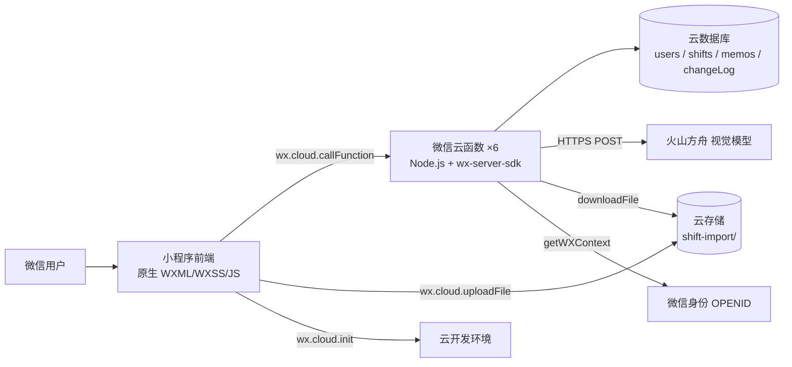

# 当前技术架构（As-Is）

> 阶段 4 产出。**只写代码中已经存在的技术栈、模块与关系。**
> 不出现“计划 / 将采用 / 建议改为 / 未来会”——那些属于 `target-architecture.md`（阶段 6）。

## 1. 架构总览

## 2. 技术栈（摘要）

| 层 | 技术 | 版本 | 证据 |
|---|---|---|---|
| 前端 | 微信小程序原生 | 基础库 3.17.3 | `project.config.json:7` |
| 后端 | 微信云函数（Node.js） | `wx-server-sdk ~2.6.3` | `cloudfunctions/*/package.json` |
| 数据 | 微信云数据库 | 平台内置 | `cloud.init` + `db.collection` |
| 存储 | 云存储 | 平台内置 | `import.js:96-99` 上传、`importShift.js:134` 下载 |
| 外部 | 火山方舟视觉 API | `ark.cn-beijing.volces.com` | `importShift/config.json`（不入库） |
| 部署 | 微信开发者工具上传 | — | 无 CI/CD |

## 3. 模块与边界

| 模块 | 职责 | 输入/输出 | 依赖 | 被谁依赖 | 不应负责什么 |
|---|---|---|---|---|---|
| `app.js` | 云初始化、会话恢复 | 无 / `globalData` | `config.js` | 全部页面 | 业务规则 |
| `utils/calendar.js` | 月网格、日期格式化 | `(year, month)` / cells | 无 | `pages/calendar` | 班次逻辑 |
| `utils/shift.js` | 班次常量、颜色、显示名 | `config.js` | `config.js` | calendar/login/import/members | 权限 |
| `components/calendar` | 月历展示与点击事件 | `cells` / `selectday`、`longpressday` | 无 | `pages/calendar` | 数据请求 |
| `pages/login` | 登录、绑定、未绑定导入 | 微信身份 / session | login、manageMember、importShift | tabBar 前置 | 重复实现导入全流程 |
| `pages/calendar` | 月历、成员切换、改班、备忘录、删成员 | session / UI | getShifts、updateShift、manageMemo、manageMember | tabBar | 权限兜底 |
| `pages/import` | 图片导入全流程 | 图片 / preview→commit | importShift | tabBar | 识别实现 |
| `pages/members` | 成员列表/解绑/移除 | session / UI | manageMember | mine | 新增成员 |
| `pages/mine` | 身份、统计、入口 | session / UI | getShifts | tabBar | 统计口径定义 |
| `pages/memo` | 个人备忘录 CRUD | 文本 / 列表 | manageMemo | mine | 年份建模 |
| `cloudfunctions/login` | 身份判定、自动建档、多记录合并 | OPENID / role,name | users | 前端登录 | 成员管理 |
| `cloudfunctions/getShifts` | 按月/年读排班与成员 | year,month / shiftsMap | users,shifts | calendar、mine | 权限过滤 |
| `cloudfunctions/updateShift` | 改班/清空 + 日志 | name,shift,dates / ok,count | users,shifts,changeLog | calendar | 权限校验（现状没有） |
| `cloudfunctions/importShift` | 识别、归位、入库、建成员 | fileID/preview / preview,count | 云存储、ARK、users、shifts | import、login | 成员管理（现状越界） |
| `cloudfunctions/manageMember` | list/bind/create/add/remove/unbind | action... / members,ok | users,shifts | login、members、calendar | 导入业务 |
| `cloudfunctions/manageMemo` | 个人备忘录 CRUD | action,text,id / memos,ok | memos | memo、calendar | 排班业务 |
| `sync-config.py` | 参数分发 | 清单 JSON / 前端+云函数配置 | Python | 运维 | 运行时逻辑 |

## 4. 运行时与部署形态

- 进程/服务数量：1 个小程序前端 + 6 个云函数（按需冷启动）+ 1 个云数据库 + 1 个云存储桶
- 部署方式：微信开发者工具上传小程序；右键云函数「上传并部署（云端安装依赖）」
- 端口/域名：无自建端口；外部域名仅 `ark.cn-beijing.volces.com`（云函数出口）
- 静态资源/CDN：无自建；小程序包由微信托管
- 定时任务/后台进程：无
- 环境：云开发环境 `paiban-...`（完整值见清单，非密钥）

## 5. 核心数据流

| 数据 | 入口 | 处理模块 | 存储 | 出口 | 证据 |
|---|---|---|---|---|---|
| 身份 | `getWXContext().OPENID` | login / manageMember | `users` | 前端 `storage.session` | `login/index.js:10-40` |
| 截图 | 相册/聊天文件 | uploadFile → importShift → ARK | 云存储 + `shifts` | 日历 | `import.js:87-158` |
| 排班修改 | 日历点选 | updateShift | `shifts` + `changeLog` | 日历重载 | `calendar.js:324-353` |
| 备忘录 | 手动输入 | manageMemo | `memos` | memo 页 / 日历 | `memo.js:67-138` |
| 成员 | 绑定/新建/导入 | manageMember / importShift / login | `users` | 成员列表 | `manageMember/index.js:38-98` |

## 6. 集成与外部依赖

| 依赖 | 用途 | 配置位置 | 失败时行为 | 证据 |
|---|---|---|---|---|
| 微信云开发 | 函数/数据库/存储/身份 | `miniprogram/config.js` env | 全部云调用失败 | `app.js:14` |
| 火山方舟视觉 API | 截图识别 | `cloudfunctions/importShift/config.json` | 返回假数据（配置缺失）或报错/重试 | `importShift/index.js:128-187,288-351` |
| 微信选图/文件 API | 选择截图 | — | 用户取消/失败提示 | `import.js:30-85` |

## 7. 安全与权限（现状）

- 认证方式：微信 `OPENID`（云函数 `getWXContext`），无独立账号体系；前端 `storage.session` 保存 `{openid, role, name}`。
- 授权模型：
  - 管理员 = `ADMIN_OPENIDS` 白名单 **或** 数据库 `users.role === 'admin'`；
  - 成员 = 其余登录用户；
  - 后端**只有** `manageMember` 的 `checkAdmin` 一处校验（`manageMember/index.js:10-19`）。
- 敏感数据位置：`users.openid`、AI Key（云函数 config）、真实排班。
- 已知薄弱点：
  - `updateShift` / `importShift` 无权限校验（`updateShift/index.js:21`、`importShift/index.js:73-99`）；
  - `manageMember.list` 把 openid 返回给所有登录用户（`:28-35`）；
  - 前端 `storage.session` 可被改，不能作为权限依据；
  - 无频率限制；
  - 密钥曾进入 Git。

## 8. 技术债与结构问题

| 位置 | 问题 | 影响 | 证据 |
|---|---|---|---|
| `pages/login` | 与 `pages/import` 重复实现导入 | 行为漂移、维护翻倍 | `login.js:174-386` |
| `importShift/index.js` | 371 行，识别/归位/建成员/入库耦合 | 难测试、难改 | 文件规模 |
| `importShift/index.js:90-99` | 导入流程越界写 `users` | 成员表可被污染 | 源码 |
| `calendar.js:5-6` | `DEFAULT_SHIFTS` 与 `config.js` 双源 | 班次不一致 | 源码 |
| `getShifts` | 无分页、硬 `limit(1000/2000)` | 静默截断 | `getShifts/index.js:23,45` |
| 全项目 | 无测试、无 lock、无 CI | 回归无保障 | 文件系统 |

## 9. 证据来源

- 源码：`miniprogram/**`、`cloudfunctions/**`
- 配置：`project.config.json`、`miniprogram/config.js`、`cloudfunctions/*/package.json`
- 关联文档：`docs/module-map.md`（调用链）、`docs/tech-stack.md`（版本）、`docs/data-model.md`、`docs/api-contract.md`

## 10. 待确认事项

1. 线上云函数运行时/超时/内存（Q-006）。
2. 云数据库实际索引与数据量（Q-006）。
3. 权限模型是否为“成员只能改自己”（Q-001/Q-002）。
