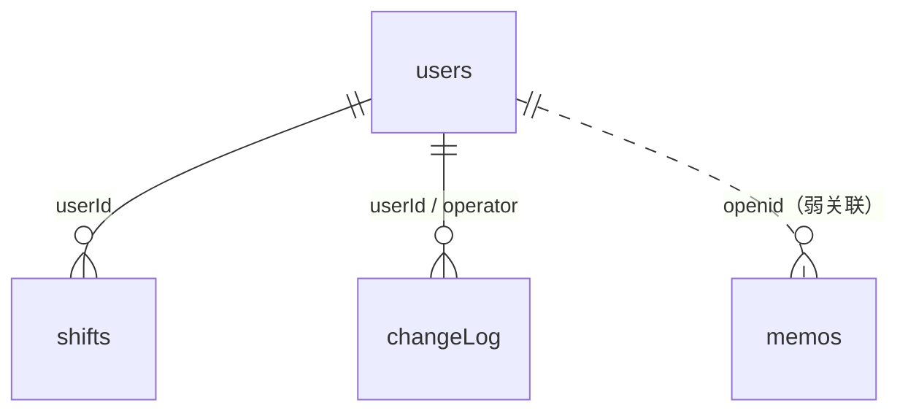

# 数据模型

> 阶段 4 产出。字段以真实代码中的读写为准；云数据库为文档型、无迁移脚本、无强 schema。
> 标 `[未知]` 的项需要云开发控制台确认。

## 1. 数据库概况

| 项 | 内容 |
|---|---|
| 类型/版本 | 微信云数据库（文档型，平台内置版本 `[未知]`） |
| 连接方式 | 云函数内 `cloud.database()`；前端不直连 |
| 迁移工具 | 无（无迁移脚本、无 schema 文件） |
| 字符集/时区 | UTF-8；日期为字符串 `YYYY-MM-DD`；时间为 `db.serverDate()` |
| 索引 | `[未知]`（需控制台确认；代码高频按 `users.openid`、`users.name`、`shifts.userId+date` 查询） |

## 2. 集合清单

| 集合 | 用途 | 预估数据量 | 证据 |
|---|---|---|---|
| `users` | 成员与身份 | 小团队（≤100） | `login`、`manageMember`、`importShift` |
| `shifts` | 每人每天一条排班 | 成员数 × 31 / 月 | `getShifts`、`updateShift`、`importShift` |
| `memos` | 个人备忘录（按 openid） | ≤100 / 人 | `manageMemo` |
| `changeLog` | 排班修改日志（容错写入，可能未创建） | 与改班次数同量级 | `updateShift/index.js:43-50` |

## 3. 关键结构

### users

| 字段 | 类型 | 可空 | 默认值 | 说明 |
|---|---|---|---|---|
| `_id` | string | 否 | 自动 | 主键，`shifts.userId` 引用它 |
| `openid` | string | 是 | `''` | 绑定微信后写入；未绑定为空 |
| `name` | string | 是 | — | 正式名/昵称，导入与改班用它定位成员 |
| `wxId` | string | 是 | `''` | 预留，当前未使用 |
| `role` | string | 是 | `member` | `admin` / `member` |
| `createdAt` | Date | 是 | `db.serverDate()` | 创建时间 |

- 主键：`_id`
- 索引：`[未知]`；无唯一索引证据 → **同名/重复记录可能产生**
- 关系：1 个 user → N 个 `shifts`（`userId`）
- 软删除：无；`remove` 直接删文档
- 审计字段：`createdAt`

### shifts

| 字段 | 类型 | 可空 | 默认值 | 说明 |
|---|---|---|---|---|
| `_id` | string | 否 | 自动 | 主键 |
| `userId` | string | 否 | — | 指向 `users._id`（不是 openid） |
| `date` | string | 否 | — | `YYYY-MM-DD`，无校验 |
| `shiftType` | string | 是 | — | 班次文本（休/正/售后/A/B/正A/正B/售A/售B/IEB/年假 等） |
| `updatedBy` | string | 是 | — | **类型不一致**：`updateShift` 写 `users._id`（`index.js:35`），`importShift` 写 `OPENID`（`index.js:105`） |
| `updatedAt` | Date | 是 | `db.serverDate()` | 更新时间 |

- 主键：`_id`
- 索引：`[未知]`；代码按 `userId + date` 查询，但**没有唯一约束** → 并发/重复导入可能产生同人同天多条
- 关系：N shifts → 1 user
- 软删除：无；取消排班 = 删除文档
- 审计字段：`updatedBy`、`updatedAt`、`changeLog`

### memos

| 字段 | 类型 | 可空 | 默认值 | 说明 |
|---|---|---|---|---|
| `_id` | string | 否 | 自动 | 主键 |
| `openid` | string | 否 | — | 归属人（微信身份，不是成员名） |
| `text` | string | 否 | — | 备忘录原文，约定“几月几号…” |
| `createdAt` | Date | 是 | `db.serverDate()` | 创建时间 |

- 关系：按 `openid` 归属；**与 `users` 无外键** → 解绑/换绑后备忘录跟随微信身份，不跟随成员
- 无年份字段 → 跨年无法区分（BUG-008）
- 无软删除；`remove` 直接删

### changeLog

| 字段 | 类型 | 可空 | 默认值 | 说明 |
|---|---|---|---|---|
| `_id` | string | 否 | 自动 | 主键 |
| `userId` | string | 是 | — | 被修改成员的 `users._id` |
| `date` | string | 是 | — | 被修改日期 |
| `oldShift` | string | 是 | `''` | 改前班次 |
| `newShift` | string | 是 | `''` | 改后班次（清空为 `''`） |
| `operator` | string | 是 | — | 操作者 `users._id` |
| `time` | Date | 是 | `db.serverDate()` | 修改时间 |

- 写入失败被 `try/catch` 吞掉（`updateShift/index.js:43-50`）→ 集合不存在也不影响主流程
- 无读取入口，无保留策略

## 4. 关系图

## 5. 迁移与兼容

| 迁移 | 内容 | 是否可回滚 | 风险 |
|---|---|---|---|
| 无 | 项目无迁移脚本、无 schema 版本 | 不适用 | 字段变更靠代码兼容，无历史版本 |

补充事实：

- `getShifts` 把 `userId` 映射为 `name`（`getShifts/index.js:48-55`）；成员改名或重名会错位。
- `manageMember.remove` 先删 `shifts` 再删 `users`（`index.js:95-96`），不是事务；中途失败会留下孤儿排班。
- `importShift` 自动创建 `users`（`index.js:90-99`），可能产生无排班、无绑定的空成员。

## 6. 证据来源

- `cloudfunctions/login/index.js`、`manageMember/index.js`、`getShifts/index.js`、`updateShift/index.js`、`importShift/index.js`、`manageMemo/index.js`
- `miniprogram/pages/*` 对字段的使用
- 无数据库 dump（未获授权），数据量/索引标 `[未知]`

## 7. 待确认事项

1. 线上集合实际行数、是否存在重复 `users.name` / 同人同天多条 `shifts`（Q-006）。
2. 是否需要为 `users.name`、`shifts(userId,date)` 建唯一索引（阶段 6 决定）。
3. `updatedBy` 统一为 `userId` 还是 `openid`（阶段 7）。
