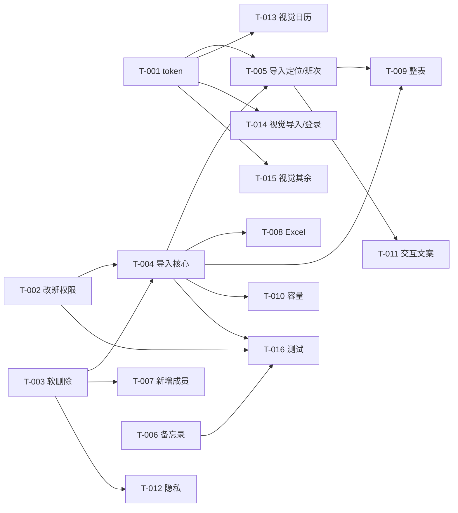

# 总体实施计划

> 阶段 6 产出。每个任务可独立验收、独立回滚；高风险任务单独标注。
> 任务卡五段：目标 / 修改范围（含禁止项）/ 验收标准（可数）/ 测试要求 / 报告格式。
> 进度记录见 `docs/progress.md`。

## 1. 规则

- 按依赖顺序执行，先做能验证的最小闭环。
- 每个任务只改允许的文件；范围外先问。
- 每个任务必须带自动化或手工验收证据；未运行写“未执行”。
- 高风险（权限/数据/删除/覆盖）先备份，再改；单独确认。
- 一个任务未通过验收，不开始依赖它的任务。
- 只描述任务，不预生成整份业务代码。

## 2. 目标与里程碑

| 里程碑 | 目标 | 包含任务 | 完成标准 | 预计时间 |
|---|---|---|---|---|
| M1 安全与数据 | 权限、软删除、导入语义正确 | T-001～T-004 | 越权/覆盖/软删用例通过 | 1–2 天 |
| M2 功能补齐 | 前端定位、班次、备忘录、成员、Excel、整表、容量、交互 | T-005～T-012 | 对应用例通过，旧功能回归 | 2–3 天 |
| M3 视觉换新 | 新 token 全量落地 | T-013～T-015 | 旧色值=0、对比度/截图通过 | 1–2 天 |
| M4 质量收口 | 测试基线 + 文档 + 发布准备 | T-016 + 阶段 8 | `node --test` 全绿、验收计划四态齐全 | 1 天 |

> 时间仅为工作量估算，不含用户等待与开发者工具登录时间。

## 3. 任务总表

| ID | 目标 | 优先级 | 依赖 | 预计修改模块 | 验收标准（摘要） | 测试方式 | 风险/确认 | 状态 |
|---|---|---|---|---|---|---|---|---|
| T-001 | 设计 token 与班次色盘落地 | P0 | 无 | `app.wxss`、`人工必填参数清单.json`→`config.js` | token 存在；班次色=新盘；旧值在 `app.wxss` 为 0 | 脚本 + 编译 | 低 | 未开始 |
| T-002 | 改班权限 + 日期校验 + updatedBy | P0 | 无 | `cloudfunctions/updateShift/index.js` | 越权拒绝、本人/管理员通过、非法日期拒绝 | 单测/手工 | **高** | 未开始 |
| T-003 | 软删除成员并保留排班 | P0 | 无 | `manageMember`、`getShifts`、`login`、`importShift`、`updateShift`、`calendar`、`members` | 删除后列表/日历消失；shifts 行数不变 | 手工 + 单测 | **高** | 未开始 |
| T-004 | 导入权限 + 真覆盖 + 年份 + 日期合法性 | P0 | T-002、T-003 | `importShift/index.js`、`import.js`、`login.js` | 越权拒绝；缺日清空；年份正确；无非法日期 | 手工 + 单测 | **高** | 未开始 |
| T-005 | 导入后定位 + 完整班次/取消 | P0 | T-001、T-004 | `calendar.js/wxml`、`utils/shift.js`、`import.js` | 导入 11 月→显示 11 月；弹窗 12 项；取消后记录=0 | 手工 | 中 | 未开始 |
| T-006 | 备忘录年份 | P1 | 无 | `manageMemo`、`memo.js/wxml`、`calendar.js` | 跨年隔离；时间非空 | 单测 + 手工 | 中 | 未开始 |
| T-007 | 管理员新增成员入口 | P1 | T-003 | `members.js/wxml` | 新增后 users+1 并显示未绑定 | 手工 | 低 | 未开始 |
| T-008 | Excel 导入 | P1 | T-004 | `importShift`（parseExcel）、`import.js/wxml`、`login.js` | 3 人×5 天 xlsx → 15 条；失败有提示 | 单测 + 手工 | 中 | 未开始 |
| T-009 | 管理员整表导入（全部） | P1 | T-004、T-005 | `import.js/wxml`、`importShift` | 一次调用入库 N 人；AI 调用 1 次 | 手工 | 中 | 未开始 |
| T-010 | 容量与危险默认值 | P1 | T-004 | `getShifts`、`importShift`、`updateShift` | >1000 条完整；缺 AI 配置返回失败 | 单测 + 手工 | 中 | 未开始 |
| T-011 | 交互与文案一致性 | P1 | T-003、T-005 | `calendar.js/wxml`、`members.js` | 灰格不写入；文案一致；管理员默认首个真实成员 | 手工 | 低 | 未开始 |
| T-012 | 隐私最小化 | P2 | T-003 | `manageMember`、`members.wxml`、`login.js` | 非管理员 list 无 openid；成员页不展示 | 手工 | 低 | 未开始 |
| T-013 | 视觉迁移：日历页 | P0 | T-001 | `pages/calendar/*.wxss`、`components/calendar/*.wxss` | 旧色值=0；对比度通过；390/768 无溢出 | 截图 + 脚本 | 中 | 未开始 |
| T-014 | 视觉迁移：导入/登录页 | P0 | T-001 | `pages/import/*`、`pages/login/*` | 同上 | 截图 + 脚本 | 中 | 未开始 |
| T-015 | 视觉迁移：我的/备忘录/成员页 | P0 | T-001 | `pages/mine/*`、`pages/memo/*`、`pages/members/*` | 同上 | 截图 + 脚本 | 中 | 未开始 |
| T-016 | 测试基线与回归 | P1 | T-002、T-004、T-006 | `tests/`、必要纯函数抽取 | `node --test` 全绿；覆盖日期/覆盖/权限/解析 | 自动 | 中 | 未开始 |

## 4. 任务卡

### T-001 设计 token 与班次色盘落地

- **目的**：建立唯一视觉令牌层与全新班次色盘，为后续页面迁移提供基础。
- **前置条件**：`ui-design.md` 2.2 节已确认；备份与基线存在。
- **涉及模块/文件**：`miniprogram/app.wxss`；`人工必填参数清单.json`（只改班次颜色，不动密钥）；运行 `同步参数.bat` 生成 `miniprogram/config.js`。
- **允许修改范围**：`app.wxss`、清单的 `班次颜色`、生成的 `config.js`。
- **明确禁止**：不手改 `config.js` 以外的生成文件；不改页面 WXSS（留给 T-013～015）；不改密钥/环境/白名单。
- **实施步骤**：① 在 `page` 上定义 CSS 变量（颜色/字号/圆角/间距）；② 清单里把 8 个班次色替换为目标值；③ 运行同步脚本；④ 确认页面仍可编译（班次色变化属预期）。
- **验收标准**：`app.wxss` 含 `--color-primary:#0F766E` 等 10 个变量；`config.js` 的班次色 = 目标盘；对 8 个班次色白字对比脚本全部 ≥4.5；旧主色 `#3B82F6` 在 `app.wxss` 出现 0 次。
- **自动化测试**：Node 颜色/对比脚本；JSON 校验。
- **人工验收**：打开日历，班次块颜色变深但文字仍清晰。
- **失败恢复**：`git revert` 本任务 commit；重新运行同步脚本。
- **风险等级**：低。
- **需批准**：无（G5 已覆盖）。

### T-002 改班权限 + 日期校验 + updatedBy

- **目的**：成员只能改自己，管理员可改全部；拒绝非法日期；审计字段统一。
- **前置条件**：D-006 确认；T-001 不阻塞。
- **涉及模块/文件**：`cloudfunctions/updateShift/index.js`（+ 可选同目录 `auth.js`）。
- **允许修改范围**：该函数目录内。
- **明确禁止**：不改入参名；不删除“取消”语义；不修改 `shifts` 结构。
- **实施步骤**：① 查当前 openid 对应 user；② 管理员判定（白名单/role，复用同一逻辑）；③ 非管理员且 `target._id !== me._id` → 拒绝；④ 校验日期格式与月份天数；⑤ `updatedBy` 写 `me._id`；⑥ 保留 changeLog。
- **验收标准**：成员改自己 `ok:true`；成员改他人 `ok:false`；管理员改任意 `ok:true`；`2026-02-30` 被拒；3 条用例全部有输出。
- **自动化测试**：纯函数单测（权限判定/日期校验）+ 手工调用。
- **人工验收**：普通成员界面只显示自己；管理员可切人改班。
- **失败恢复**：`git revert`；云函数重新部署上一版。
- **风险等级**：**高**（认证/权限）。
- **需批准**：G5 覆盖；部署前需用户确认（阶段 8）。

### T-003 软删除成员并保留排班

- **目的**：删除成员只隐藏，保留 `shifts`，与文案一致、可恢复。
- **前置条件**：D-008；线上数据已备份。
- **涉及模块/文件**：`manageMember`（remove/list）、`getShifts`、`login`、`importShift`、`updateShift`、`calendar.js`、`members.js`。
- **允许修改范围**：上述文件。
- **明确禁止**：不物理删除 `users/shifts`；不改集合名；不删除历史数据。
- **实施步骤**：① `remove` 改为 `isDeleted:true, deletedAt`；② 所有 `users` 查询加“非删除”条件（兼容无字段旧数据）；③ 前端文案统一“成员隐藏、排班保留”；④ 同名新增提示“已存在（可能已隐藏）”。
- **验收标准**：删除后 `users` 文档仍在且 `isDeleted=true`；`shifts` 行数不变；列表/日历/导入/改班 4 处均查不到该成员；同名新增被拒绝。
- **自动化测试**：查询过滤纯函数单测 + 手工。
- **人工验收**：删除后刷新，成员消失但历史排班仍在（管理员通过数据库或恢复后可见）。
- **失败恢复**：`git revert` + 把 `isDeleted` 改回 false。
- **风险等级**：**高**（数据语义）。
- **需批准**：G5 覆盖。

### T-004 导入权限 + 真覆盖 + 年份 + 日期合法性

- **目的**：成员只能导入自己；导入=该月全量替换；写入年份/月份正确；拒绝非法日期。
- **前置条件**：T-002、T-003 完成。
- **涉及模块/文件**：`cloudfunctions/importShift/index.js`、`miniprogram/pages/import/import.js`、`pages/login/login.js`。
- **允许修改范围**：上述文件。
- **明确禁止**：不改 preview 结构（`{name,rows:[{date,shift}]}` 可扩展字段但不删）；不删除预览校对环节；不关闭识别失败提示。
- **实施步骤**：① commit 阶段校验目标成员 = 本人或管理员；② 年份/月来源：事件 `year/month` > 标题解析 > 当前年（前端传用户选择/导入目标月）；③ 计算差异：新增/覆盖/清空；④ 只删除“该成员 + 该月”内未出现在 preview 的日期；⑤ 校验日期合法；⑥ 返回 `{added,updated,removed}` 供确认。
- **验收标准**：成员导入他人 `ok:false`；管理员导入任意人 `ok:true`；1–31 号有数据→只导 1–5 号后 6–31 号记录数=0；`2026-02-31` 写入数=0；导入“2025年12月”全部日期以 `2025-12-` 开头。
- **自动化测试**：覆盖差异纯函数、日期校验单测。
- **人工验收**：导入后预览显示“新增 X / 覆盖 Y / 清空 Z”，清空 Z>0 时二次确认。
- **失败恢复**：先备份该月 `shifts`；`git revert`；必要时按备份回写。
- **风险等级**：**高**（批量删除）。
- **需批准**：G5 覆盖；首次真机导入前用户确认。

### T-005 导入后定位 + 完整班次/取消

- **目的**：导入后看到对应成员与月份；成员可选 11 种班次并取消。
- **前置条件**：T-001、T-004。
- **涉及模块/文件**：`pages/calendar/calendar.js/wxml`、`utils/shift.js`、`pages/import/import.js`。
- **允许修改范围**：上述文件。
- **明确禁止**：不改页面路由；不删除批量改班；不改变 `shifts` 结构。
- **实施步骤**：① 导入成功后写 `importTarget = {name, year, month}`；② 日历 `onShow` 读取并设置年月/成员；③ `shiftOptions` 统一 = `SHIFT_TYPES + 取消`；④ 图例同源；⑤ 取消写空串删除。
- **验收标准**：导入 11 月 → 日历标题为 11 月且选中该成员；普通成员弹窗 12 项；点“取消”后该日记录数=0；图例项数=12。
- **自动化测试**：`getMonthGrid`/选项构造纯函数单测。
- **人工验收**：真机走一遍导入→跳转→改班→取消。
- **失败恢复**：`git revert`。
- **风险等级**：中。

### T-006 备忘录年份

- **目的**：备忘录按年份隔离，时间戳可读。
- **前置条件**：无。
- **涉及模块/文件**：`cloudfunctions/manageMemo/index.js`、`pages/memo/memo.js/wxml`、`pages/calendar/calendar.js`。
- **允许修改范围**：上述文件。
- **明确禁止**：不删除现有备忘录；不改 `text` 约定（仍以“X月X号”开头）。
- **实施步骤**：① `add` 写 `year`（默认当年，允许“今年/明年”选择）；② `list` 返回 `year`；③ 前端按 `year+month` 分组/过滤；④ 时间戳用 `createdAt instanceof Date` 或 ISO 字符串格式化。
- **验收标准**：2026 年 10 月的备忘不在 2027 年 10 月显示；时间显示非空（≥10 字符）；旧数据（无 year）按 createdAt 年份归组。
- **自动化测试**：年份解析/分组纯函数单测。
- **人工验收**：添加跨年备忘录，切到次年日历确认不显示。
- **失败恢复**：`git revert`；旧数据未被修改。
- **风险等级**：中。

### T-007 管理员新增成员入口

- **目的**：管理员可在成员管理页新增成员（未绑定）。
- **前置条件**：T-003（同名/软删规则）。
- **涉及模块/文件**：`pages/members/members.js/wxml/wxss`。
- **允许修改范围**：上述文件。
- **明确禁止**：不改 `manageMember.add` 入参；不开放给非管理员。
- **实施步骤**：① 页面加“新增成员”按钮与输入；② 调 `add`；③ 成功后刷新列表；④ 错误提示。
- **验收标准**：新增“张三”→ `users` +1、列表出现、状态“未绑定”；非管理员看不到按钮；同名报错。
- **自动化测试**：无（手工 3 步）。
- **人工验收**：新增后让该成员登录绑定。
- **失败恢复**：`git revert` + 删除测试成员（软删）。
- **风险等级**：低。

### T-008 Excel 导入

- **目的**：上传 .xlsx 可解析为与截图一致的 preview。
- **前置条件**：T-004。
- **涉及模块/文件**：`cloudfunctions/importShift/index.js`（`parseExcel`）、`pages/import/import.js/wxml`、`pages/login/login.js`。
- **允许修改范围**：上述文件。
- **明确禁止**：不改 preview 结构；不删除图片导入路径。
- **实施步骤**：① `chooseMessageFile` 增加 `.xlsx/.xls`；② `downloadFile` + `xlsx.read`；③ 识别表头日期与姓名列；④ 组装 preview；⑤ 失败提示“表头格式不支持”。
- **验收标准**：3 人×5 天样例 → preview 3 人、每人 5 行；入库 15 条；空表/错误表头返回 `ok:false`。
- **自动化测试**：用固定 xlsx fixture 的纯解析单测。
- **人工验收**：真实排班表上传一次。
- **失败恢复**：`git revert`（依赖已存在，无需卸载）。
- **风险等级**：中。

### T-009 管理员整表导入（全部）

- **目的**：管理员一次识别导入全员，减少 AI 调用次数。
- **前置条件**：T-004、T-005。
- **涉及模块/文件**：`pages/import/import.js/wxml`、`cloudfunctions/importShift/index.js`。
- **允许修改范围**：上述文件。
- **明确禁止**：不放开给普通成员；不改变单人导入路径。
- **实施步骤**：① 管理员多人识别后显示“全部导入”；② commit 传全部 preview；③ 权限校验（管理员）；④ 成功提示导入人数/条数。
- **验收标准**：管理员选“全部” → 入库 N 人；视觉 API 调用 1 次；普通成员无该选项。
- **自动化测试**：手工 + 日志计数。
- **人工验收**：8 人表一次导入。
- **失败恢复**：`git revert`。
- **风险等级**：中。

### T-010 容量与危险默认值

- **目的**：大月份/多成员不丢数据；配置缺失不写假数据。
- **前置条件**：T-004。
- **涉及模块/文件**：`cloudfunctions/getShifts/index.js`、`importShift/index.js`、`updateShift/index.js`。
- **允许修改范围**：上述文件。
- **明确禁止**：不改返回结构；不删除 mock 函数以外的东西（可保留但不可在生产路径调用）。
- **实施步骤**：① `getShifts` 分页拉取（每页 1000，循环 skip）；② `yearData` 同理；③ 缺 AI 配置时返回 `{ok:false,msg:'识别服务未配置'}`；④ 可选：每 openid 每日导入次数限制。
- **验收标准**：造 1200 条排班 → 返回 1200 条；缺配置调用 → `ok:false`；正常配置不受影响。
- **自动化测试**：分页拼接纯函数单测。
- **人工验收**：团队人数增加后日历完整。
- **失败恢复**：`git revert`。
- **风险等级**：中。

### T-011 交互与文案一致性

- **目的**：消除灰格误写、删除文案矛盾、管理员默认伪成员。
- **前置条件**：T-003、T-005。
- **涉及模块/文件**：`pages/calendar/calendar.js/wxml`、`pages/members/members.js`。
- **允许修改范围**：上述文件。
- **明确禁止**：不改路由与数据结构。
- **实施步骤**：① 灰格点击不写（或提示切月）；② 删除文案统一“成员隐藏、排班保留”；③ 管理员默认选首个真实成员；④ 空态去掉灰圆占位。
- **验收标准**：点灰格后 `shifts` 记录数不变；两处删除文案一致；管理员首次进入选中非“管理员”成员。
- **自动化测试**：手工 3 步。
- **人工验收**：管理员/成员各走一次。
- **失败恢复**：`git revert`。
- **风险等级**：低。

### T-012 隐私最小化

- **目的**：非管理员不再拿到/看到 openid。
- **前置条件**：T-003。
- **涉及模块/文件**：`manageMember/index.js`、`members.wxml`、`login.js`。
- **允许修改范围**：上述文件。
- **明确禁止**：不破坏登录页“判断哪些成员未绑定”的能力（改为返回 `isBound`/`isSelf`）。
- **实施步骤**：① `list` 按调用者角色裁剪 openid；② 增加 `isSelf`/`isBound` 布尔；③ 成员页移除 openid 展示；④ 登录页改用布尔。
- **验收标准**：成员调用 `list` 无 `openid` 字段；管理员可见；登录页绑定流程不变。
- **自动化测试**：手工 2 次调用。
- **人工验收**：成员打开成员页看不到 openid。
- **失败恢复**：`git revert`。
- **风险等级**：低。

### T-013 视觉迁移：日历页

- **目的**：日历页（含组件）使用新 token。
- **前置条件**：T-001；开发者工具登录（Q-010）。
- **涉及模块/文件**：`pages/calendar/calendar.wxss`、`components/calendar/calendar.wxss`。
- **允许修改范围**：上述样式文件；必要时 WXML 的 class（不改结构）。
- **明确禁止**：不改交互逻辑；不改班次色语义；不引入第三方组件。
- **实施步骤**：① 替换硬编码颜色为变量；② 字号/圆角/间距按 2.2；③ 修月选择器对比度与批量按钮定位；④ 截 390/768 图。
- **验收标准**：该页旧色值出现 0 次；文字对比 ≥4.5；触控 ≥88rpx；截图无溢出。
- **自动化测试**：旧值检索脚本 + 对比度脚本。
- **人工验收**：真机查看 3 种状态（有数据/空/多选）。
- **失败恢复**：`git revert` 本批 commit。
- **风险等级**：中。

### T-014 视觉迁移：导入/登录页

（同上；文件：`pages/import/*`、`pages/login/*`；重点：按钮、面板、预览标签、错误提示。）

### T-015 视觉迁移：我的/备忘录/成员页

（同上；文件：`pages/mine/*`、`pages/memo/*`、`pages/members/*`；重点：统计数字、列表行、输入框、空态。）

### T-016 测试基线与回归

- **目的**：为纯函数与关键逻辑建立可重复测试。
- **前置条件**：T-002、T-004、T-006。
- **涉及模块/文件**：新增 `tests/`；必要时把纯函数抽到 `cloudfunctions/*/lib/`（不改变对外行为）。
- **允许修改范围**：`tests/`、纯函数抽取文件。
- **明确禁止**：不为测试改变业务语义；不引入重量级测试框架（用 `node:test`）。
- **实施步骤**：① 抽出日期校验、覆盖差异、权限判定、姓名归并、年份分组；② 写用例；③ `node --test` 跑通；④ 记录命令与数量。
- **验收标准**：`node --test tests/` 全部通过，用例数 ≥ 20；覆盖 5 类纯函数。
- **自动化测试**：`node --test tests/`。
- **人工验收**：无。
- **失败恢复**：`git revert`。
- **风险等级**：中。

## 5. 依赖关系

## 6. 高风险任务专项

| 任务 | 风险 | 备份方案 | 回滚演练 | 批准人 |
|---|---|---|---|---|
| T-002 | 权限误判导致成员无法改自己 | 基线 + 云函数版本 | 未演练（发布前在测试环境演练） | 用户（G5） |
| T-003 | 软删除过滤遗漏导致数据不一致 | 云数据库导出/快照 | 未演练 | 用户（G5） |
| T-004 | 全量覆盖误删整月排班 | 目标月份 shifts 导出 JSON | 未演练（必须先演练） | 用户（G5 + 首次导入确认） |
| T-008/T-009 | 解析错误批量入库 | 同 T-004 | 未演练 | 用户（G5） |

## 7. 计划外变更

| 日期 | 变更 | 原因 | 对范围/工期影响 | 批准人 |
|---|---|---|---|---|
| — | — | — | — | — |

## 8. 完成定义（DoD）

- [ ] 代码改动在允许范围内
- [ ] `git diff` 已审查
- [ ] 测试已运行并记录四态
- [ ] 验收标准逐条通过
- [ ] 文档/进度已更新
- [ ] 回滚方式已确认

## 9. 动代码前的反向审查五问（2026-10-25）

1. **有没有遗漏的依赖或调用方？**
   - `getShifts` 返回结构被 `calendar.js`（3 处）与 `mine.js`（1 处）消费；改字段必须同步 4 处。
   - `users` 查询分布在 6 个云函数（login/updateShift/importShift/manageMember/getShifts/manageMemo 的 openid 查询），软删除过滤必须逐处检查。
   - `config.js` 由清单生成，改班次色必须改清单再同步，不能手改生成文件。
2. **有没有不必要的架构重构？能不能只改一个函数？**
   - 不重写导入模块；在 `importShift` 内补权限、覆盖差异与 `parseExcel`。
   - 不抽公共云函数包；权限判定在 2 个函数内各写一小段（约 15 行），避免引入构建/共享层。
3. **有没有更小、更安全的实现？**
   - 软删除用新增字段 + 查询过滤，不迁移数据；旧数据无字段按“未删除”处理。
   - 视觉换新先落 `app.wxss` 变量，再逐页替换；不做组件库。
   - 导入覆盖先算差异、预览展示“新增/覆盖/清空”，清空 >0 时二次确认。
4. **哪些结论仍缺少证据？**
   - 线上数据量/重复记录、云函数超时/内存（Q-006）。
   - 真机长按与 tap 行为、AI 识别成功率（需登录开发者工具）。
   - 旧版小程序兼容性（需旧包实测）。
5. **回滚方案在真实环境里能执行吗？**
   - 代码：每个任务独立 commit，`git revert` 可回退；云函数重新上传上一版。
   - 数据：软删除可改回 `isDeleted=false`；导入覆盖前导出目标月份 `shifts` JSON，可按备份回写。
   - 视觉：按批次 commit，可只回退某一页。

> 结论：可以进入实施，但 T-002/T-003/T-004 必须先备份并在测试成员 + 空月份验证；视觉任务需先解决开发者工具登录。
