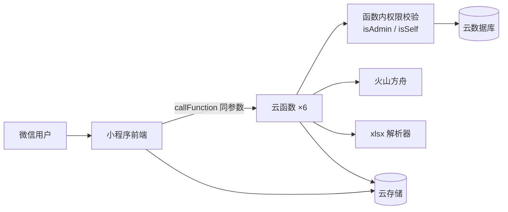

# 目标技术架构与演进（To-Be）

> 阶段 6 产出。**本文全部是“计划”，不是现状**。现状见 `architecture.md`。
> 用户批准（G5）后才进入实施。

## 1. 目标与原则

- 本次演进要解决的问题：权限缺失、导入语义错误、软删除缺失、班次选项受限、备忘录无年份、视觉可读性不足、无测试。
- 设计原则（按优先级）：
  1. **不改技术栈**：继续用小程序原生 + 云开发，避免迁移风险；
  2. **后端强制权限**：所有写接口在云函数内校验，前端只做体验；
  3. **单一配置源**：班次/颜色/别名只来自《人工必填参数清单.json》→ 生成配置；
  4. **数据安全**：软删除、导入前预览差异、清空需确认；
  5. **外科手术式改动**：不改公共入参，旧版小程序仍可调用。
- 明确不改变的部分：小程序原生框架、云开发环境、6 个云函数的名称与调用方式、`users/shifts/memos/changeLog` 集合名、页面路由。

## 2. 目标架构

| 层 | 目标技术/结构 | 与现状差异 | 理由 | 风险 |
|---|---|---|---|---|
| 前端 | 原生小程序 + CSS 变量 token | 新增 token 层，去掉颜色硬编码 | 可读性/一致性 | 全页面 WXSS 改动 |
| 前端 | 单一班次源 `config.SHIFT_TYPES` + `取消` | 删除 `DEFAULT_SHIFTS` | 消除双源 | 选项变多，布局需验证 |
| 云函数 | 每个写函数内置 `isAdmin/isSelf`（小段重复代码） | 从“无校验”到“有校验” | 云函数独立部署，无法可靠共享目录 | 改错会误拒合法请求 |
| 云函数 | `importShift` 增 `parseExcel`、覆盖差异计算 | 从空实现到可用 | Excel + 真覆盖 | 误识别导致误删 |
| 数据 | `users.isDeleted/deletedAt`、`memos.year` | 新增字段 | 软删除/年份 | 旧数据无字段需兼容 |
| 数据 | `updatedBy` 统一为 `users._id` | 统一类型 | 审计可读 | 历史数据混存 |
| 测试 | `node:test` 纯函数单测 + 手工集成 | 从 0 到有 | 回归保障 | 云函数依赖需 mock |

## 3. 模块边界

| 模块 | 目标职责 | 与现状差异 | 迁移方式 |
|---|---|---|---|
| `cloudfunctions/updateShift` | 权限 + 日期校验 + upsert/删除 + 日志 | 新增权限与校验 | 原地改 |
| `cloudfunctions/importShift` | 权限 + 识别 + 姓名归位 + 覆盖差异 + 入库 | 新增权限/覆盖/Excel | 原地改 |
| `cloudfunctions/manageMember` | 成员 CRUD + 软删除 + openid 最小暴露 | 改 remove/list | 原地改 |
| `cloudfunctions/getShifts` | 过滤软删除 + 分页 | 改查询 | 原地改 |
| `cloudfunctions/manageMemo` | 年份字段 + 校验 + 时间格式 | 改 add/list | 原地改 |
| `cloudfunctions/login` | 过滤软删除成员 | 改查询 | 原地改 |
| `miniprogram/utils/shift.js` | 班次列表/颜色/取消 的单一入口 | 去硬编码 | 原地改 |
| `miniprogram/app.wxss` | 设计 token（CSS 变量） | 新增 | 新增变量，逐页替换 |
| `pages/calendar` | 导入后定位、完整班次、灰格禁用、默认成员 | 修交互 | 原地改 |
| `pages/import` | 权限化选人、整表、Excel、差异确认 | 改流程 | 原地改 |
| `pages/members` | 新增成员、软删除文案、不显示 openid | 改 UI | 原地改 |

## 4. 迁移步骤

| 步骤 | 内容 | 前置条件 | 验证方式 | 回滚方式 |
|---|---|---|---|---|
| 1 | `app.wxss` 建 CSS 变量；清单→`config.js` 换新班次色 | 无 | 对比度脚本 + 编译 | `git revert` |
| 2 | `updateShift` 权限/日期/updatedBy | 步骤 1 不阻塞 | 越权用例 + 合法用例 | revert 单文件 |
| 3 | 软删除字段与全查询过滤 | 线上数据备份 | 删除后列表/日历/导入验证 | revert + 数据回写 |
| 4 | `importShift` 权限/覆盖/年份/日期 | 步骤 2、3 | 覆盖用例、错月用例 | revert 云函数 |
| 5 | 前端导入定位 + 班次选项 | 步骤 1、4 | 真机/模拟器 | revert 页面 |
| 6 | 备忘录年份、新增成员、Excel、整表导入 | 步骤 2–5 | 对应用例 | 按任务 revert |
| 7 | 容量/危险默认值/交互文案 | 步骤 4 | 边界用例 | 按任务 revert |
| 8 | 视觉分批替换（calendar → import/login → 其余） | 步骤 1 + 开发者工具登录 | 390/768 截图 + 旧色值=0 | 按批次 revert |

> 原则：先兼容、再切换、最后清理；每步独立可回退。

## 5. 兼容性影响

| 影响面 | 说明 | 是否需要用户确认 |
|---|---|---|
| 数据 | 新增 `users.isDeleted/deletedAt`、`memos.year`；旧数据按“字段不存在=未删除/年份取 createdAt 年”兼容；`updatedBy` 历史值不动 | 是（G5） |
| 接口 | 云函数名与入参不变；新增拒绝分支（越权返回 `ok:false`）；`manageMember.list` 对非管理员去掉 openid | 是（旧版前端可能依赖 openid 判断“自己”，需改为返回 `isSelf` 标志） |
| 配置 | 班次色盘更新；清单仍是唯一来源 | 否 |
| 客户端 | 旧版小程序：权限拒绝会显示后端 `msg`；导入仍可调用（参数兼容）；软删除成员不再出现 | 是（需接受旧版行为变化） |

## 6. 被否定的方案

| 方案 | 为什么不做 | 重新考虑的条件 |
|---|---|---|
| 重写为自建后端/其他框架 | 成本高、丢失微信登录与云开发能力 | 需要多团队/公网 API/复杂权限时 |
| 抽公共 npm 包给 6 个云函数共享 | 云函数各自部署，需构建流程；当前只有 2 处用到 | 函数数量/共享逻辑明显增加 |
| 单独 `auth` 云函数供其他函数调用 | 每次多一次网络调用与冷启动 | 权限规则复杂到需集中管理 |
| 物理删除成员并保留排班 | 会产生孤儿 `userId`，查询不可恢复 | 不适用 |
| 导入直接覆盖不预览 | 误识别会整月误删 | 不适用（必须保留预览 + 差异确认） |

## 7. 风险与缓解

| 风险 | 概率 | 影响 | 缓解措施 |
|---|---|---|---|
| 权限校验误拒合法请求 | 中 | 成员无法改自己 | 先查 `users.openid` 对应成员，再做 `isSelf`；保留管理员白名单；用例覆盖 |
| 全量覆盖误删整月 | 中 | 数据丢失 | 预览显示“新增/覆盖/清空”数量；清空 >0 时二次确认；仅处理目标月份；先备份 |
| 软删除过滤遗漏某个查询 | 中 | 已删成员仍出现/可被改 | 统一 helper + 全量检索 `users` 查询点；用例覆盖 6 个函数 |
| 视觉迁移新旧混用 | 高 | 界面不一致 | 按页分批 + 旧色值=0 作为判据 + 每批截图 |
| 旧版小程序不兼容 | 低 | 旧客户端报错 | 入参不变；新增字段可选；拒绝分支返回可展示 msg |
| Excel 表头差异 | 中 | 解析失败 | 先支持“日期横排 + 姓名列”，失败给明确提示，不强猜 |

## 8. 批准记录

| 版本 | 日期 | 批准人 | 批准范围 |
|---|---|---|---|
| v0.1 | 2026-10-25 | 待用户（G5） | 本文件 + `implementation-plan.md` + `acceptance-test-plan.md` |

## 9. 待确认事项

1. 线上云函数超时/内存与数据量（Q-006）——影响分页与导入超时策略。
2. 开发者工具登录（Q-010）——影响视觉验收与真机验证。
3. 软删除成员的“恢复”入口是否本期做（当前 P2）。
