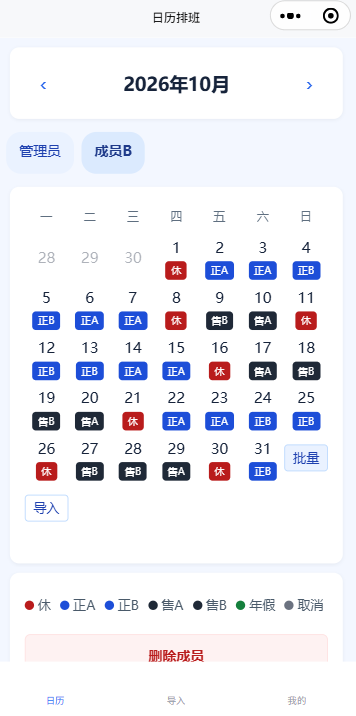
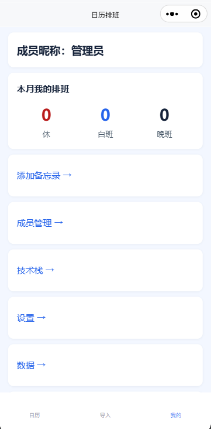
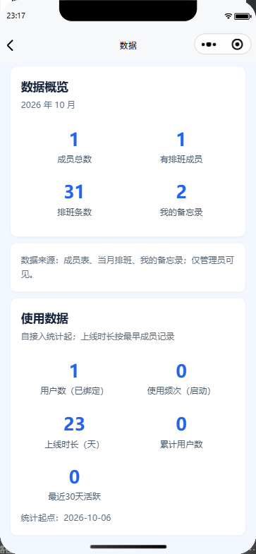

# 功能说明（含页面截图）

> 截图使用演示账号：成员名统一显示为「成员B」，管理员显示为「管理员」；**真实姓名已隐藏/替换**。含密钥的界面不纳入公开截图。
>
> 截图目录：[docs/showcase](showcase/)。

## 一句话

拍一张排班截图，AI 识别成结构化班表；成员看自己的日历、点选改班，管理员负责导入、成员和配置。

## 功能地图

| 模块 | 能做什么 |
|---|---|
| 日历 | 月视图、成员/管理员视角、4/6 状态、点选改班、长按批量、空月导入入口 |
| 导入 | 截图/Excel、目标月份、识别预览校对、整月覆盖、非法日期丢弃 |
| 成员管理 | 新增、绑定、改名、解绑、软删除（保留历史排班） |
| 我的 | 备忘录、成员管理、数据入口 |
| 数据 | 成员/排班/备忘录概览 + 使用统计（用户数、启动次数、上线时长、累计用户、近30天活跃） |

## 1. 日历：每个人看自己的班

- 默认显示当前月，周一为第一列；
- 成员视角只显示自己的排班；管理员可切换成员；
- 点某天改班，长按进入多选批量；
- 当月没有排班时，「批量」旁出现「导入」；有排班或手动改班后自动隐藏；
- 4 状态（休/白班/晚班/年假）与 6 状态（休/正A/正B/售A/售B/年假）可切换。

## 2. 导入：截图 → 校对 → 入库

1. 选择「导入到哪个月」（可选；不选则按截图月份）；
2. 上传截图或 Excel；
3. AI 识别后逐项校对，点班次可循环切换；
4. 按「成员 + 月份」整月覆盖入库；
5. 目标月不存在的日期（如 11-31）丢弃并提示。

## 3. 成员管理：管理员维护成员

- 新增成员、绑定微信、解绑；
- **改名**：行内输入新名字，保存后立即生效；只改 `users.name`，排班按 `userId` 关联，历史排班不丢；
- 重名（含已删除）、管理员记录、非管理员操作都会被拒绝；
- 移除为软删除，列表隐藏但保留历史数据。

## 4. 我的：一个入口页

- 添加备忘录、成员管理、数据；
- 每个入口独立卡片，管理员与成员看到的入口不同。

## 5. 数据：概览 + 使用统计

- 概览：成员总数、有排班成员、排班条数、我的备忘录；
- 使用数据：用户数（已绑定）、使用频次（启动）、上线时长、累计用户、近 30 天活跃；
- 仅管理员可见；统计从接入 `usageLogs` 后开始，历史访问无法追溯。

## 6. 权限与数据边界

| 角色 | 能做什么 |
|---|---|
| 成员 | 看/改自己的排班、自己的备忘录 |
| 管理员 | 看/改全部排班、切换成员、导入、成员管理、数据 |

- 身份用微信 OPENID；
- 所有写操作在云函数侧重新判定，前端 `session` 只用于渲染；
- 排班按 `users._id` 关联，改名/软删除不影响历史；
- 6 个集合：`users`、`shifts`、`memos`、`changeLog`、`settings`、`usageLogs`。

## 7. 质量与运行

- 9 个页面 + 9 个云函数；
- 36 个测试文件 / 158 条用例（`node --test`）；
- 部署与操作步骤见 [操作手册](操作手册.md)；
- 架构与决策见 [architecture.md](architecture.md)、[decisions.md](decisions.md)。
